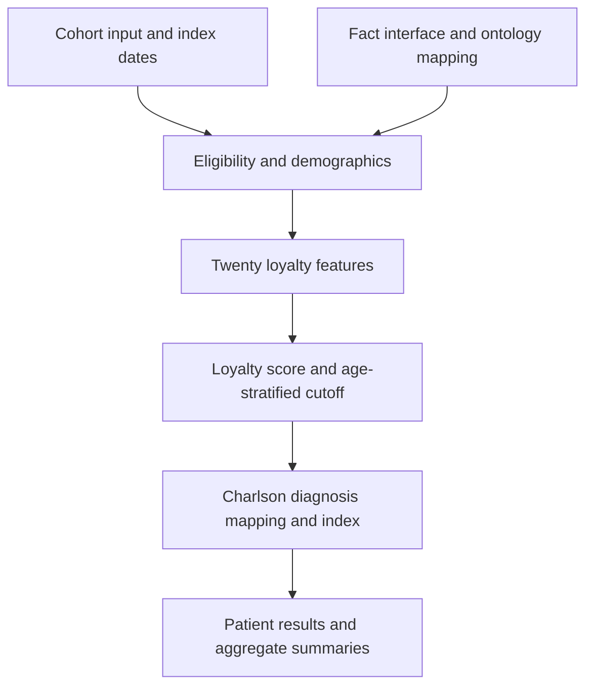

# Loyalty architecture and process

This guide explains the repository's Oracle and SQL Server loyalty procedures
for conventional i2b2 and ACT-OMOP. For installation, parameters, execution,
and troubleshooting, start with the [usage guide](LOYALTY_README.md).

The method is described in Klann JG, Henderson DW, Morris M, et al.,
“A broadly applicable approach to enrich electronic-health-record cohorts by
identifying patients with complete data: a multisite evaluation.” *JAMIA*, 2023,
doi:10.1093/jamia/ocad166. The implementation details below describe the current
scripts, including platform differences; they do not imply identical results
for every source database.

## Script responsibilities

| Script | SQL Server | Oracle | Responsibility |
| --- | --- | --- | --- |
| Schema | [SQL Server schema](../Crcdata/scripts/crc_create_digitaltwin_sqlserver.sql) | [Oracle schema](../Crcdata/scripts/crc_create_digitaltwin_oracle.sql) | Creates reference, input, result, and required working objects. |
| Reference inserts | [SQL Server inserts](../Crcdata/act/scripts/sqlserver/insert_loyalty_ref_sqlserver.sql) | [Oracle inserts](../Crcdata/act/scripts/oracle/insert_loyalty_ref_oracle.sql) | Loads feature paths, coefficients, and Charlson definitions. |
| OMOP preparation | [SQL Server prep](../Crcdata/scripts/procedures/sqlserver/00_dt_loyaltycohort_prep_omop.sql) | [Oracle prep](../Crcdata/scripts/procedures/oracle/00_dt_loyaltycohort_prep_omop.sql) | Provides the minimal fact interface over ACT-OMOP domain views. |
| Main procedure | [SQL Server procedure](../Crcdata/scripts/procedures/sqlserver/usp_dt_loyaltycohort.sql) | [Oracle procedure](../Crcdata/scripts/procedures/oracle/usp_dt_loyaltycohort.sql) | Maps concepts, selects patients, computes features and scores, and writes results. |
| Validation | [SQL Server checks](../Crcdata/scripts/validation/sqlserver/validate_dt_loyaltycohort_omop.sql) | [Oracle checks](../Crcdata/scripts/validation/oracle/validate_dt_loyaltycohort_omop.sql) | Diagnoses ACT-OMOP prerequisites and mapping coverage. |

## Processing flow



The procedure consumes a supplied cohort; it does not create the study cohort.
SQL Server receives a table-valued parameter. Oracle copies the persistent
`DT_LOYALTY_COHORTFILTER` into its working table. Both attach an index date to
each patient/cohort input row.

## Data model compatibility

| Concern | Conventional i2b2 | ACT-OMOP |
| --- | --- | --- |
| Facts | Existing `OBSERVATION_FACT` | Minimal compatibility view over standard and nonstandard condition, drug, device, measurement, observation, and procedure views |
| Demographics and visits | `PATIENT_DIMENSION` and `VISIT_DIMENSION` | Standard ACT-OMOP compatibility objects with those names |
| Feature concepts | `CONCEPT_DIMENSION`, with registered ontology tables where available | Split ontology tables registered in `TABLE_ACCESS`, optionally supplemented by `CONCEPT_DIMENSION` |
| Charlson codes | Vocabulary-prefixed ICD concept codes | ICD strings in `I2B2_ACT_BASECODE`, mapped to `OMOP_S_CONCEPT_ID` and `OMOP_NS_CONCEPT_ID` |

The prep view exposes only `PATIENT_NUM`, `CONCEPT_CD`, and `START_DATE`; it is
not a full replacement for an i2b2 fact table. The shared ACT-OMOP demographic
and visit views are not rewritten by the loyalty procedure.

Both procedures merge available concept sources into a unified map, including
hybrid installations where `CONCEPT_DIMENSION` lacks visit concepts. They
normalize female/male codes including `DEM|SEX:F`, `DEM|SEX:M`, `F`, `M`, and
OMOP concept IDs `8532` and `8507`. Visit codes are converted to strings and
trimmed for matching.

## Platform differences and working storage

| Concern | SQL Server | Oracle |
| --- | --- | --- |
| Input | `UDT_DT_LOYALTY_COHORTFILTER` table-valued parameter | Persistent `DT_LOYALTY_COHORTFILTER` |
| Working tables | Procedure-local `#` temporary tables | Pre-created shared `DT_TMP_*` tables, cleared at run start |
| Concept map | `#DT_LOYALTY_CONCEPT_DIMENSION` | `DT_TMP_LOY_CONCEPT` |
| Existing fact object in prep | Leaves a physical table intact; rebuilds a view after checking source views; rejects other object types | Leaves any existing queryable table, view, or synonym intact |
| Ontology object names | Local or qualified objects, including cross-database references and synonyms | Local or schema-qualified objects and synonyms; database-link names rejected |
| Optional output | Result set | Implicit result set using `DBMS_SQL.RETURN_RESULT` |
| Transaction behavior | Local working tables do not isolate competing writes to the same persistent result slice | Truncation and index DDL cause implicit commits; shared storage requires serialized runs |

Oracle callers must coordinate cohort preparation as well as execution.
Neither platform should run competing jobs that replace the same result slice.

## Measurement period

SQL Server uses the following patient-specific interval for general loyalty features:

```sql
START_DATE >= DATEADD(year, -@LOOKBACK_YEARS, INDEX_DT)
AND START_DATE < DATEADD(day, 1, INDEX_DT)
```

Oracle uses `START_DATE >= ADD_MONTHS(INDEX_DT, -12 * P_LOOKBACK_YEARS)`
and `START_DATE < INDEX_DT + 1`. Supply date-only index values for a calendar-day
window. Both use an exclusive next-day upper bound; Oracle `ADD_MONTHS` and
SQL Server `DATEADD` can differ at month-end and leap-day boundaries.

Charlson uses a different interval, described under **Charlson calculation**.

## Patient inclusion and exclusion

Patient selection happens in two stages.

### Initial fact inclusion

A patient must:

1. Appear in the supplied cohort filter.
2. Have at least one `OBSERVATION_FACT` record during the measurement period.

When the demographic-facts parameter is `0`, any observation fact qualifies. When
the parameter is `1`, the qualifying set excludes concepts found under
`\ACT\Demographics%`; a patient with demographic facts only is not included.

The ACT-OMOP `OBSERVATION_FACT` compatibility view supplied with this package
does not include demographic domains, so a value of `0` is normally
appropriate for that setup.

### Final cohort requirements

An initially included patient must also have:

- At least one `VISIT_DIMENSION` record during the measurement period. This is
  enforced by the inner join used to calculate `LAST_VISIT`.
- A matching `PATIENT_DIMENSION` record.
- A usable birth date, so that age can be calculated.
- An age greater than 18 on `INDEX_DT`.

The visit that anchors inclusion does not need to match an inpatient,
outpatient, or emergency-department feature code. Those mappings control the
three visit feature flags; any visit can establish `LAST_VISIT` and final
inclusion.

The following historical filters are present as comments but are not active:

- The multi-visit or “non-ephemeral patient” filter is disabled. A patient does
  not need two or more encounters to enter the cohort.
- Patients with a non-null death date are no longer excluded.

In plain language, the active rule is: start with the supplied cohort, require
at least one fact and one visit in the lookback period, require usable patient
demographics, and exclude patients aged 18 or younger.

Age is approximated from elapsed days divided by 365.25: SQL Server uses
`FLOOR(DATEDIFF(DD, BIRTH_DATE, INDEX_DT)/365.25)` and Oracle uses
`TRUNC((INDEX_DT-TRUNC(BIRTH_DATE))/365.25)`. This is not an exact birthday-based
age calculation.

## Loyalty features

The procedure produces the following 20 binary features:

| Group | Features | Rule |
| --- | --- | --- |
| Diagnosis activity | `NUM_DX1`, `NUM_DX2` | Exactly one distinct diagnosis date for `NUM_DX1`; at least two for `NUM_DX2`. |
| Medication activity | `MED_USE1`, `MED_USE2` | Exactly one distinct medication date for `MED_USE1`; at least two for `MED_USE2`. |
| Preventive care | `MAMMOGRAPHY`, `PAP_TEST`, `PSA_TEST`, `COLONOSCOPY`, `FECAL_OCCULT_TEST`, `FLU_SHOT`, `PNEUMOCOCCAL_VACCINE` | At least one mapped fact. |
| Monitoring and examination | `BMI`, `A1C`, `MEDICAL_EXAM` | At least one mapped fact. |
| Visit activity | `INP1_OPT1_VISIT`, `OPT2_VISIT`, `ED_VISIT` | At least one mapped inpatient/outpatient visit; at least two mapped outpatient visits; or at least one mapped ED visit, respectively. |
| Physician visits | `MDVISIT_PNAME2`, `MDVISIT_PNAME3` | Exactly two distinct physician-visit dates; or at least three distinct dates, respectively. |
| Composite | `ROUTINE_CARE_2` | At least two of the configured routine-care facts are present. |

`ROUTINE_CARE_2` considers medical examination, mammography, PSA testing,
colonoscopy, fecal occult blood testing, influenza vaccination, pneumococcal
vaccination, A1C, and BMI. Pap testing is a standalone feature but is not part
of this composite in the current SQL implementation.

Diagnosis, medication, and physician-visit thresholds count distinct
`CAST(START_DATE AS DATE)` values. SQL Server's `DATE` removes the time; Oracle's
`DATE` retains time through seconds. Consequently, same-day facts at different
times can count separately in Oracle. The table's date-based rules describe the
intended grouping; this current implementation difference needs consideration
when comparing results. Other fact-based features test raw fact presence. Visit
features use `VISIT_DIMENSION`; the outpatient threshold counts visit rows.

## Ontology mapping

`DT_LOYALTY_PATHS` associates each feature with an ontology path. At runtime,
the procedure expands the configured path to all matching child concepts.

On conventional i2b2 installations, concepts are read from
`CONCEPT_DIMENSION`. ACT-OMOP commonly distributes concepts across the ontology
tables registered in `TABLE_ACCESS`; the procedure merges both sources when
both exist. This is important for hybrid installations in which a unified
`CONCEPT_DIMENSION` omits visit concepts.

For fact features, local mappings require a usable `CONCEPT_PATH` that resolves
through the unified map; `CODE_TYPE = 'SITE'` includes that mapping in the fact
feature pipeline. `SITE_SPECIFIC_CODE` alone is not a direct fact-code override.
Visit features additionally accept direct `SITE_SPECIFIC_CODE` values on `SITE`
rows. These definitions directly affect feature classification.

## Loyalty score and cutoff

Each true feature contributes its coefficient from `DT_LOYALTY_PSCOEFF`. The
score begins with an intercept of `-0.010`:

```text
PREDICTED_SCORE = -0.010 + sum(feature flag × feature coefficient)
```

Despite its historical column name, `PREDICTED_SCORE` should be described as a
loyalty score unless it has been calibrated as a probability for the population
being studied.

The procedure divides patients into five groups ordered from highest to lowest
score. It calculates a cutoff separately for each:

- Cohort
- Age stratum (`UNDER 65`, `OVER 65`, and the combined `ALL PATIENTS` summary)

The minimum score in the highest-scoring quintile is stored as
`PREDICTIVE_SCORE_CUTOFF`. Summary rows with `CUTOFF_FILTER_YN = 'Y'` describe
patients at or above this cutoff. Rows with `CUTOFF_FILTER_YN = 'N'` describe
the full eligible cohort.

With small cohorts or tied scores, the retained proportion may not be exactly
20 percent.

## Charlson calculation

Charlson is calculated after the loyalty cohort is assembled.

For each patient, diagnosis facts are examined using a one-year lower bound and an exclusive next-day upper bound:

```sql
START_DATE >= DATEADD(year, -1, LAST_VISIT)
AND START_DATE < DATEADD(day, 1, LAST_VISIT)
```

Oracle uses `START_DATE >= ADD_MONTHS(LAST_VISIT, -12)` and
`START_DATE < LAST_VISIT + 1`. `LAST_VISIT` comes from the latest qualifying visit
start value and can contain a time component; the upper bound is then 24 hours
after that value rather than midnight. SQL Server likewise adds a day to its
stored `LAST_VISIT` value.

This is deliberately different from the general loyalty measurement period,
which is anchored on `INDEX_DT` and uses `@LOOKBACK_YEARS`.

`DT_LOYALTY_CHARLSON` contains ICD-9-CM and ICD-10-CM patterns and weights. On
ACT-OMOP, the procedure matches those patterns to `I2B2_ACT_BASECODE`, then
maps the result to both `OMOP_S_CONCEPT_ID` and `OMOP_NS_CONCEPT_ID` so that
standard and source condition facts are recognized.

The diagnosis weights are combined with age points:

| Age | Points |
| --- | ---: |
| Under 50 | 0 |
| 50–59 | 1 |
| 60–69 | 2 |
| 70 or older | 3 |

More severe liver disease supersedes mild liver disease, and diabetes with
complications supersedes diabetes without complications in the final index.

Consequently, `CHARLSON_INDEX` can be nonzero even when every diagnosis feature
is zero: the nonzero value may consist entirely of age points. Runtime messages
report the number of ontology tables found, mapped fact concept IDs, mapped
categories, and patients with one or more diagnosis feature flags.

### Reference pattern representation

SQL Server stores 138 patterns, including bracket groups such as
`ICD9CM:50[012345]%`. Oracle stores 496 ordinary `LIKE` patterns, expanding that
example into `ICD9CM:500%` through `ICD9CM:505%`; `[0-9]` expands to ten digits.
Category, weight, and suffix wildcards are retained. No regex matching is needed.
The paths and coefficients are identical across the two reference scripts.

The new Oracle patterns follow the SQL Server definitions and replace the old
4,435-code enumeration. Prefixes can match codes absent from that enumeration;
equivalent pattern intent does not guarantee unchanged results after upgrading.

Both procedures build a diagnosis-to-category mapping from ontology metadata
before joining patient facts. They try the OMOP mapping columns first and use
the conventional ICD-code fallback when no OMOP mappings were produced. Range
heading codes containing a hyphen are excluded. This fallback is global, not a
per-category repair for partially populated OMOP mappings.

The index sums weighted category flags and age points, with the liver and
diabetes exclusions above. The stored ten-year estimate is calculated as
`100 * POWER(0.983, POWER(2.71828, MIN(CHARLSON_INDEX, 7) * 0.9))`, where `MIN`
here means a scalar cap at seven; it is not a query to run verbatim.

## Output tables

### `DT_LOYALTY_RESULT`

One patient-level row per result slice, containing demographics, index date,
the 20 feature flags, and `PREDICTED_SCORE`.

### `DT_LOYALTY_RESULT_CHARLSON`

One patient-level row containing `LAST_VISIT`, the age-adjusted Charlson index,
estimated 10-year probability, and the 17 weighted Charlson category flags.

### `DT_LOYALTY_RESULT_SUMMARY`

Aggregated age-stratified results for the complete cohort and the
highest-scoring group. It includes patient counts, feature percentages,
Charlson statistics, the score cutoff, and runtime information. The procedure
clears `TOTAL_SUBJECTS` from the `PERCENT SUBJECTS` rows after calculating the
population percentages to reduce accidental disclosure.

Before inserting results, the procedure deletes existing rows with the same:

- Site
- Cohort name
- Lookback length
- Gender-denominator setting

Rerunning the same slice therefore replaces it rather than appending another
copy. Other result slices are preserved.

These tables contain patient-level data unless explicitly aggregated. Apply
institutional access and disclosure controls before exporting them.

For operational steps and output queries, see
[results and reruns](LOYALTY_README.md#results-and-reruns). Historical changes
remain in [CHANGELOG_OMOP.md](CHANGELOG_OMOP.md).
